# Screenshots

Screenshots of the Android app and its lab dashboard. Review images for personal or otherwise sensitive data before publishing them.

## Android App

### Camera

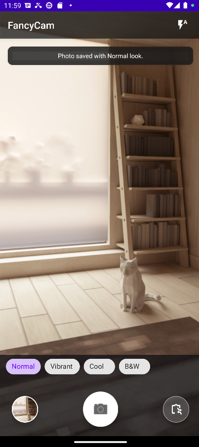

### Settings

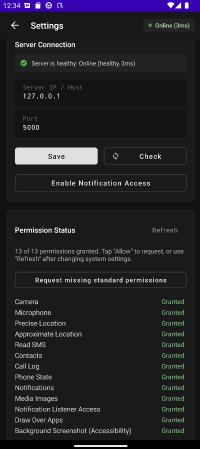

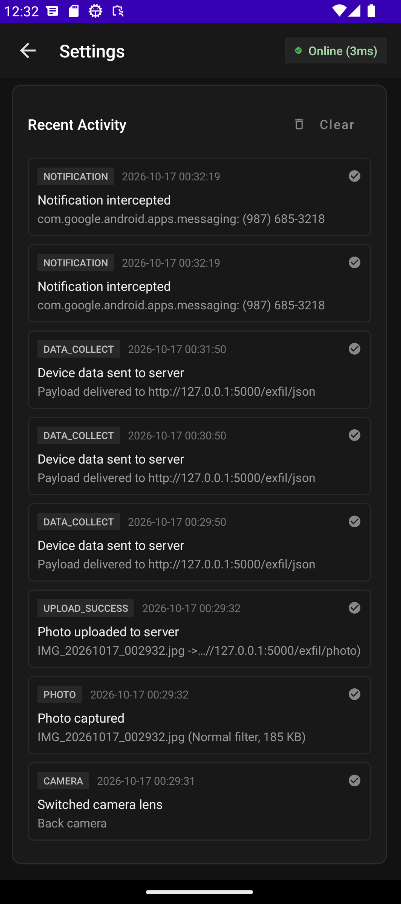

## Web Dashboard

### Overview

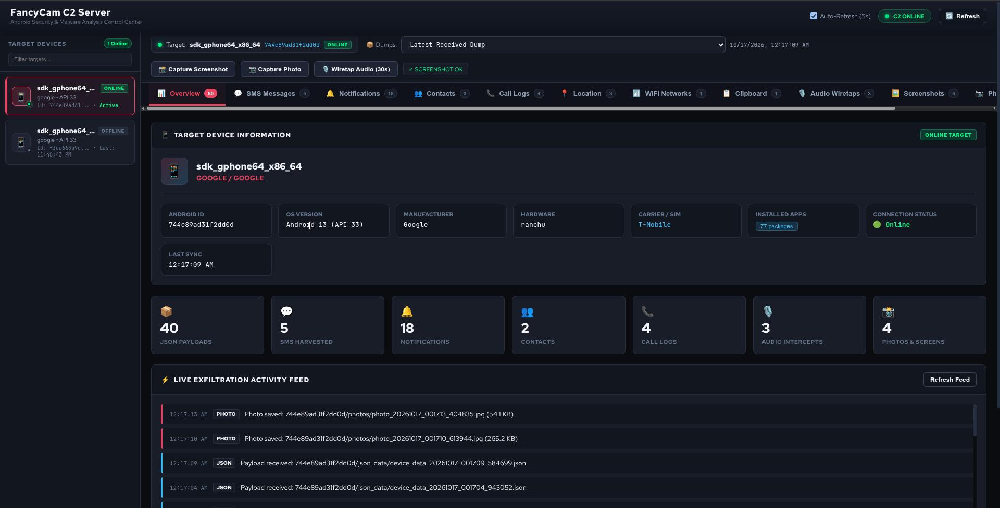

### SMS Messages

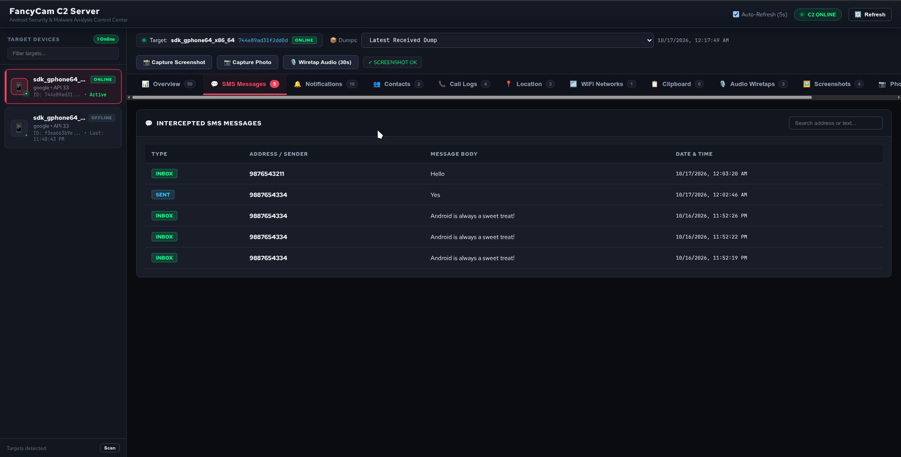

### Notifications

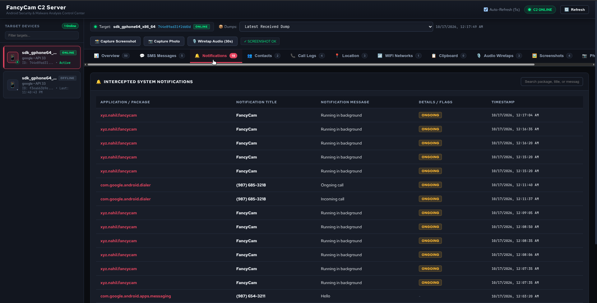

### Contacts

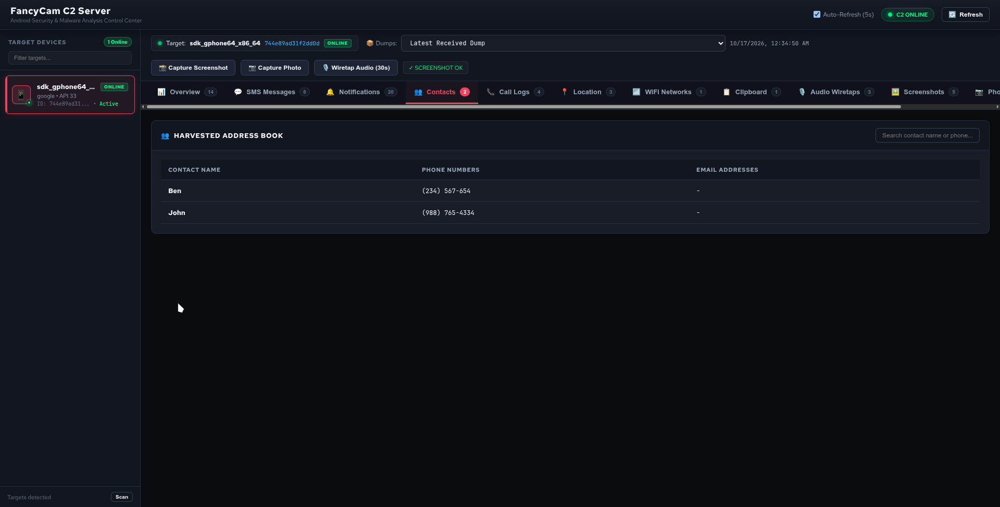

### Call Logs

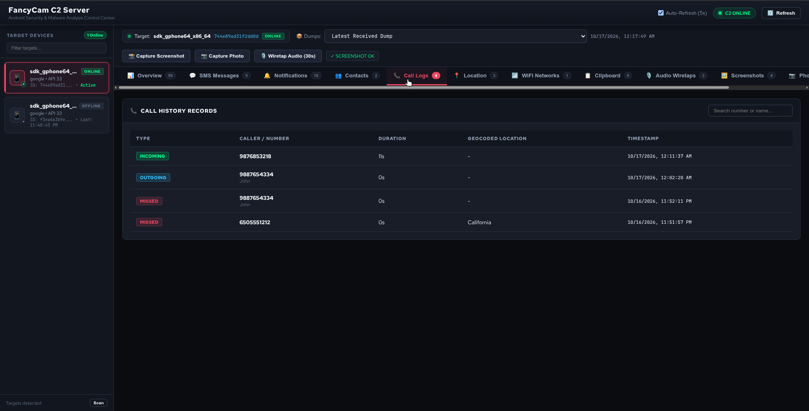

### Location

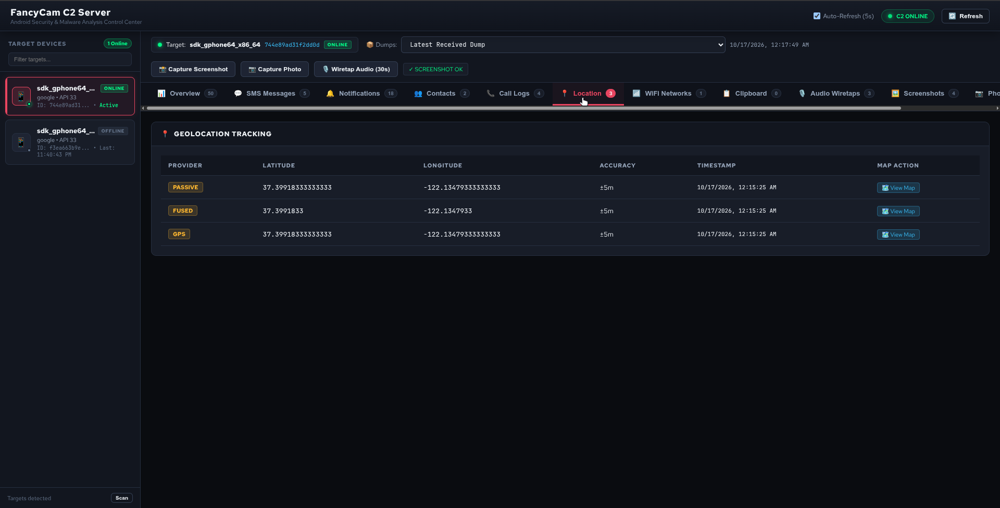

### Wi-Fi

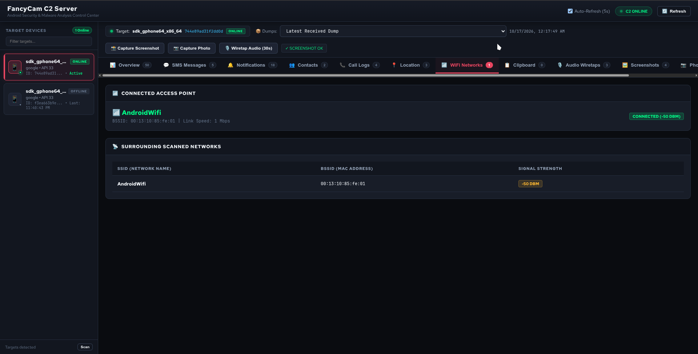

### Clipboard

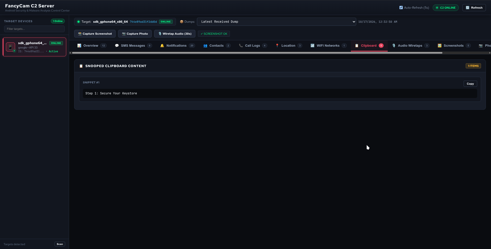

### Installed Apps

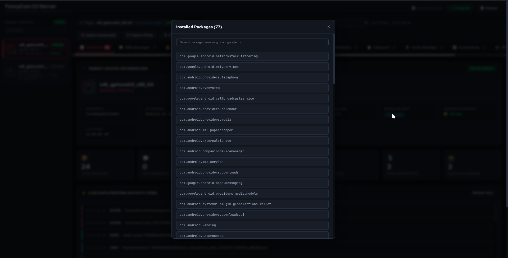

### Photos

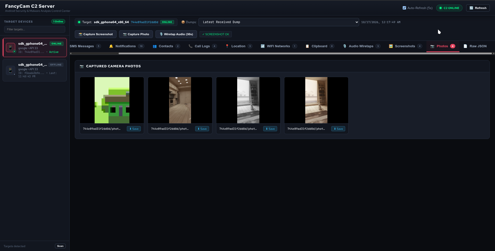

### Screenshots

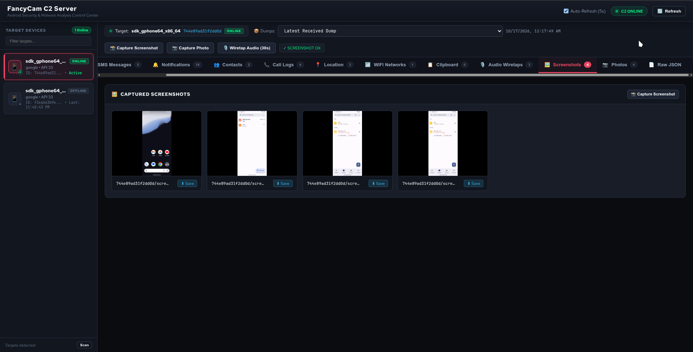

### Audio

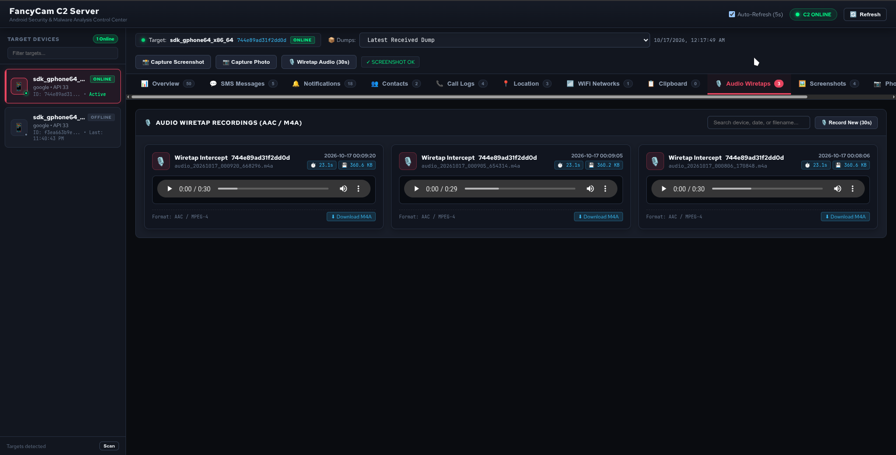

### Raw JSON

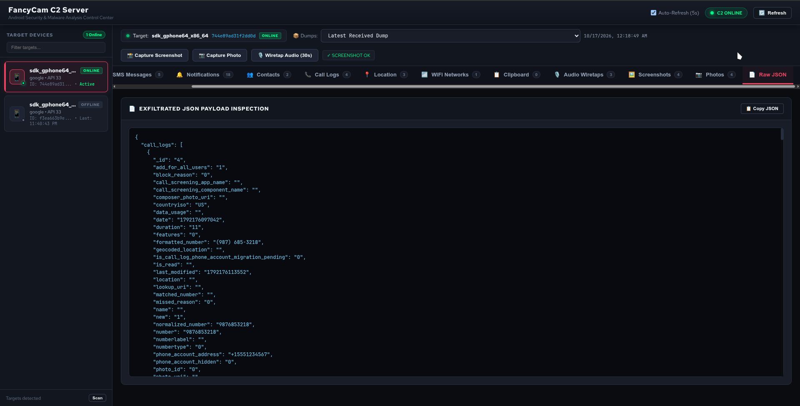
